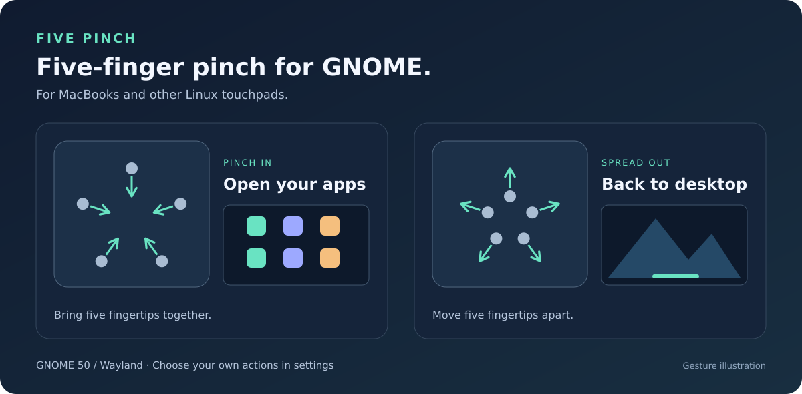

# Five Pinch

**Give your Linux laptop a five-finger shortcut to your apps.**

Pinch five fingers together to open the application grid. Spread them apart to
close it and return to your desktop. Choose different actions if you prefer.



Five Pinch started with a **2017 MacBook Pro running Ubuntu** and a missing
trackpad gesture. The goal is to bring five-finger pinch gestures to MacBooks
**and other laptops running Linux**, even when the desktop does not recognize
that gesture out of the box.

**Have a different touchpad? You're welcome to try it.** There is no brand or
model restriction. So far, it has only been tested on the 2017 MacBook Pro's
Apple SPI touchpad; other hardware may work, but has not been verified yet.

[Get started](#get-started) · [Download a .deb](https://github.com/Nymeriq/five-pinch/releases/latest) · [Report your hardware](CONTRIBUTING.md) · [MIT license](LICENSE)

## Before you install

- **GNOME 50 on Wayland**, such as Ubuntu 26.04 with its default GNOME desktop.
- A touchpad that can track **five fingers separately**.
- This is a **Linux extension**, not a macOS app. Other desktops and GNOME versions
  are not supported by the current release.

Not sure about your touchpad? You can install it and check the status in settings.
Five Pinch is experimental: detection may need work on your hardware, and other
gesture extensions can interfere. You can turn it off or uninstall it at any time.

## Get started

### 1. Install

On Ubuntu, open **Terminal** and paste these commands. They add the Five Pinch
package repository and install the app:

```bash
curl -fL https://nymeriq.github.io/five-pinch/setup-apt.sh -o /tmp/five-pinch-apt-setup.sh
sudo sh /tmp/five-pinch-apt-setup.sh
sudo apt update
sudo apt install five-pinch
```

The setup requires `curl` and `gpg`. If either is missing, install them with
`sudo apt install curl gpg`, then repeat the commands above.
[What does the repository setup change?](docs/APT.md)

Prefer a standalone installer? [Download the latest `.deb`](https://github.com/Nymeriq/five-pinch/releases/latest),
open Terminal in your Downloads folder, and run `sudo apt install ./five-pinch_0.6.0_all.deb`.
Use the filename you downloaded. This option does not add the update repository.

> [!IMPORTANT]
> **After installation, save your work, log out, and log back in.**
> This lets GNOME discover the extension and refresh touchpad access.
> Locking and unlocking the screen is not the same as logging out.

### 2. Open settings and try detection

1. Open **Five Pinch Settings** from your applications.
2. Click **Enable and open settings**.
3. Leave **Touchpad device path** empty to select your touchpad automatically.
4. Set both **Pinch in** and **Pinch out** to **Detect only (no action)**,
   then switch on **Enable recognition**.
5. Place five fingers on the touchpad and pinch inward or spread outward.
   **Lift all fingers between gestures.** Check **Last gesture** in the settings.

### Adjust the feel

**Gesture sensitivity** offers three modes, applied immediately:

- **Balanced** (default): less movement is needed than in the original release.
- **Relaxed**: smaller movements can trigger a gesture; try this if casual pinches
  are missed. If unwanted gestures occur, switch back to Balanced or Original.
- **Original (firm movement)**: the same recognition thresholds as 0.5.1.

Lift all fingers after switching modes. The change affects recognition, not
continuous animation: Five Pinch triggers a desktop action when a pinch is
recognized; it does not animate the grid in proportion to finger movement.

### 3. Choose what your gestures do

Once detection works, try this setup:

| Gesture | Setting | Result |
| --- | --- | --- |
| Pinch five fingers inward | **Pinch in → Open app grid** | See your installed applications |
| Spread five fingers outward | **Pinch out → Close app grid** | Close the app grid and return to your desktop |

You can also choose overview actions, or disable either direction. **Close app
grid** and **Close overview** are separate actions; choose the one you want.
Fresh installations start with recognition and gesture actions disabled, so
nothing happens until you configure them.

## Need a hand?

- **The app or extension doesn't appear:** log out and back in after installation.
- **No gesture is detected:** check **Recognizer** in settings. Keep the device
  field empty first; if you have multiple touchpads, see
  [how to choose your touchpad](docs/TECHNICAL.md#choosing-a-touchpad-manually).
- **Gestures behave unexpectedly:** turn off **Enable recognition** and check
  whether another gesture extension is active.
- **Previously installed from source:** the settings launcher can offer
  **Use packaged version**. It backs up the old manual copy; log out and back
  in afterwards. [Details](docs/TECHNICAL.md#previous-manual-installations).

## Updates and removal

With the repository set up, Five Pinch updates alongside your other packages.
To update just Five Pinch:

```bash
sudo apt update
sudo apt install --only-upgrade five-pinch
```

**Log out and back in after updating**, so GNOME loads the new code.
Your gesture settings are preserved.

To stop it, turn off **Enable recognition** in settings or disable **Five Pinch**
in the Extensions app. To uninstall:

```bash
gnome-extensions disable five-pinch@local.codex
sudo apt remove five-pinch
```

Log out and back in after removal. See the [APT guide](docs/APT.md) for removing
the package repository or returning to an older version.

## Help it work on more laptops

**Tested on:** 2017 MacBook Pro · Apple SPI Touchpad · Ubuntu 26.04 · GNOME 50 · Wayland.

Tried it on another MacBook or another brand? We'd love to hear what happened,
including when it doesn't work. [Open an issue](https://github.com/Nymeriq/five-pinch/issues)
with your laptop model, Ubuntu/Linux version, GNOME version, and the status shown
in settings. Please don't include passwords or other personal information.

Documentation pull requests with hardware results and code improvements are
welcome. See the [hardware reports](docs/HARDWARE.md) and
[contribution guide](CONTRIBUTING.md).

## Curious about the internals?

Five Pinch combines a GNOME Shell extension with a supervised, read-only touchpad
reader. It does not replace your touchpad driver or modify firmware. Bugs can
still affect the desktop session, and untested hardware may miss or misread gestures.

[Technical guide: compatibility, limitations, rollback, and tests](docs/TECHNICAL.md) ·
[Development notes](docs/DEVELOPMENT.md) · [APT repository](docs/APT.md)
