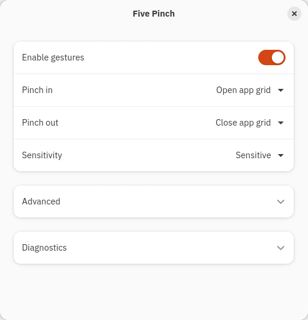

<p align="center">
  
</p>
<h1 align="center">Five Pinch</h1>
<p align="center">Five-finger pinch gestures for GNOME on Wayland.</p>
<p align="center">
  <a href="https://fivepinch.nymeriq.com">Website</a> ·
  <a href="https://fivepinch.nymeriq.com/docs/">Documentation</a> ·
  <a href="https://github.com/Nymeriq/five-pinch/releases/latest">Download</a> ·
  <a href="https://github.com/Nymeriq/five-pinch/issues">Issues</a>
</p>
<p align="center">
  <a href="https://github.com/Nymeriq/five-pinch/releases/latest"></a>
  <a href="https://fivepinch.nymeriq.com/docs/#requirements"></a>
  <a href="https://fivepinch.nymeriq.com/docs/#requirements"></a>
  <a href="LICENSE"></a>
</p>


Five Pinch started with a 2017 MacBook Pro running Ubuntu and a missing trackpad gesture. It brings five-finger pinch actions to **MacBooks and other Linux touchpads**, without a brand or model allowlist.

- **Two directions, your actions.** Open or close the app grid or overview.
- **Three sensitivities.** Original, Balanced, and Sensitive.
- **Automatic rinertia protection.** Filter leftover virtual scrolling around a five-finger interaction; no extra dependency when rinertia is absent.
- **Reversible installation.** Read-only recognition, documented reset, package removal, and rollback.

> [!NOTE]
> Requires **GNOME 50 on Wayland** and five independently tracked touch positions. Tested on a **2017 MacBook Pro / Apple SPI Touchpad / Ubuntu 26.04**. Other hardware is welcome to try, but is not yet verified. [Compatibility details →](https://fivepinch.nymeriq.com/docs/#requirements)

## Install

Add the signed APT repository and install Five Pinch:

```bash
curl -fL https://nymeriq.github.io/five-pinch/setup-apt.sh -o /tmp/five-pinch-apt-setup.sh
sudo sh /tmp/five-pinch-apt-setup.sh
sudo apt update
sudo apt install five-pinch
```

Requires `curl` and `gpg`. If missing, run `sudo apt update && sudo apt install curl gpg` first. Required application dependencies are installed by APT. **Extension Manager is optional.**

Prefer a standalone installer? [Download the latest `.deb`](https://github.com/Nymeriq/five-pinch/releases/latest) and install it with `sudo apt install ./five-pinch_0.7.2_all.deb` from its folder. This does not add the update repository.

> [!IMPORTANT]
> **Save your work, log out, and log back in after installation or upgrade.** Locking the screen is not enough.

## Set up

1. Open **Five Pinch Settings**. Click **Enable** if prompted; active installations open settings directly.
2. Choose **Detect only** for both directions, then turn on **Enable gestures**.
3. Try an inward and outward pinch. Lift all fingers between attempts. Check **Diagnostics → Last gesture**.
4. Choose your actions. A useful starting point:

| Gesture | Action |
| --- | --- |
| Pinch in | Open app grid |
| Pinch out | Close app grid |

Start with **Balanced**. Choose **Sensitive** for smaller movements, or **Original** for firmer movement. All three options change only Five Pinch's recognition, not global gesture settings.

<details>
<summary>See the settings window</summary>
<p align="center"></p>
</details>

Device selection and the two protection switches are under **Advanced**. Leave **Touchpad** empty for automatic selection. [Complete setup guide →](https://fivepinch.nymeriq.com/docs/#setup)

## How it works

A supervised Python reader tracks five stable finger positions. The GNOME extension turns a recognized pinch into an action. It does not replace your driver, modify firmware, grab the touchpad exclusively, or run a permanent root service.

The optional rinertia guard recognizes its running virtual device and filters scrolling only around five-contact interactions and their momentum tail. A new physical touchpad interaction clears that guard. Without rinertia, other pointer events pass through.

This triggers desktop actions; it does **not** provide continuous, finger-following app-grid animation. Extension bugs or conflicts can still affect a desktop session. [Architecture, permissions, protections, and limits →](https://fivepinch.nymeriq.com/docs/#how-it-works)

## Update

```bash
sudo apt update
sudo apt install --only-upgrade five-pinch
```

Log out and back in. Your settings are preserved. Ordinary system upgrades also include Five Pinch when the repository is configured.

## Uninstall

Run the reset as your own desktop user, without sudo:

```bash
five-pinch-reset
sudo apt purge five-pinch
sudo apt update
```

Log out and back in afterwards. This resets Five Pinch's own settings and removes the package and optional repository setup. On shared machines, each user should run the reset before removal; logged-out users' personal databases are not edited as root. Intentional backups and diagnostic recordings are retained. [Removal and rollback details →](https://fivepinch.nymeriq.com/docs/#uninstall)

## Documentation

[Install](https://fivepinch.nymeriq.com/docs/#install) · [Actions](https://fivepinch.nymeriq.com/docs/#actions) · [Sensitivity](https://fivepinch.nymeriq.com/docs/#sensitivity) · [rinertia](https://fivepinch.nymeriq.com/docs/#protection) · [Troubleshooting](https://fivepinch.nymeriq.com/docs/#troubleshooting) · [Rollback](https://fivepinch.nymeriq.com/docs/#updates)

For contributors: [Technical guide](docs/TECHNICAL.md) · [Development](docs/DEVELOPMENT.md) · [APT publishing](docs/APT.md) · [Plain-text documentation](https://fivepinch.nymeriq.com/docs/reference.txt)

## Contribute

Tried another touchpad? [Report your hardware](https://github.com/Nymeriq/five-pinch/issues), including your laptop model, Linux/GNOME versions, session type, and what worked or failed. Documentation and code pull requests are welcome.

See [CONTRIBUTING.md](CONTRIBUTING.md) and the [hardware reports](docs/HARDWARE.md). No claim of universal compatibility is implied.

## License

[MIT](LICENSE). A project by [Nymeriq](https://nymeriq.com).
